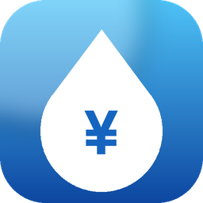

# 兴泸水务水费查询（Home Assistant 集成）

<p align="center">
  
</p>

[](https://github.com/caiwx86/lzss_water_ha/actions/workflows/validate.yml)

这是一个非官方的 Home Assistant 自定义集成，用于查询**泸州市兴泸水务**的水费账户信息。集成通过兴泸水务微信小程序使用的云端接口读取数据，并以设备实体的形式接入 Home Assistant。

> 本集成与兴泸水务集团无隶属关系，接口可能随官方小程序更新而变化。

## 功能

- **水费余额**：当前账户可用余额
- **未缴费笔数 / 未缴费金额**：欠费汇总，并附带账单明细属性
- **欠费状态**：二进制传感器，可直接用于自动化通知
- **一键刷新**：设备页面上的刷新按钮，无需等待轮询
- **UI 配置**：无需编辑 configuration.yaml
- **令牌过期自动重认证**：接口返回 token 过期时，Home Assistant 会发起重新授权流程
- **可调刷新间隔**：1–168 小时，默认 12 小时
- **诊断信息**：自动脱敏户号、Token、姓名和地址
- **品牌图标**：内置本地 icon/logo，安装后在集成页面显示（HA 2026.3+）
- **兼容性解析**：同时兼容多种 JSON 字段命名和旧版 HTML 返回，接口小改动不易失效

## 环境要求

- Home Assistant **2024.8.0** 或更高版本
- 已安装 [HACS](https://hacs.xyz/)（推荐）或可手动复制文件
- 可访问 `https://osh.lzss.com`

## 安装

### 通过 HACS 安装（推荐）

1. 打开 HACS → 集成
2. 右上角菜单 → 自定义仓库
3. 仓库地址填写 `https://github.com/caiwx86/lzss_water_ha`，类别选择 **集成**
4. 搜索“兴泸水务”并安装
5. 重启 Home Assistant

### 手动安装

1. 下载仓库最新代码或 Release
2. 将 `custom_components/lzss_water` 整个目录复制到 Home Assistant 配置目录的 `custom_components/` 下
3. 重启 Home Assistant

目录结构应类似：

```
config/
└── custom_components/
    └── lzss_water/
        ├── __init__.py
        ├── manifest.json
        └── ...
```

## 配置

> 本集成仅支持 UI 配置，不需要在 `configuration.yaml` 中添加 `lzss_water:`。如果按旧版文档添加过，请删除相关配置后重启 Home Assistant。

1. 进入 **设置 → 设备与服务 → 添加集成**
2. 搜索并选择 **兴泸水务**
3. 填写：
   - **户号**：水费户号（通常可在水费单或小程序中查看）
   - **访问令牌（Token）**：见下方获取方法
4. 点击提交，集成会先调用接口验证；验证通过后创建账户设备

### 获取访问令牌

Token 来自兴泸水务微信小程序：

1. 在手机微信中打开兴泸水务小程序并登录
2. 使用抓包工具（如 Reqable、Charles、Stream）抓取小程序的 HTTPS 请求
3. 找到请求 `https://osh.lzss.com/wx_lz/bill/arrearageKoi`
4. 复制请求头中的 `Authorization` 值，填入集成配置（若包含 `Bearer ` 前缀，请一并保留）

> Token 等同于账户访问凭证，请勿截图或粘贴到公开 Issue。Token 过期后集成会提示重新授权，重新抓包并填写新 Token 即可，无需删除重装。

### 修改刷新间隔

进入 **设置 → 设备与服务 → 兴泸水务 → 配置**，可设置 1–168 小时的更新间隔。修改后集成会自动重载。

默认 12 小时。水费数据变化不频繁，不建议设置过短的间隔，以免给官方接口造成压力。

## 实体

实体 ID 由 Home Assistant 根据设备名和账户自动生成，实际值请在 **开发者工具 → 状态** 中查看。下表以户号 `12345678` 为例：

| 实体 | 类型 | 说明 |
| --- | --- | --- |
| `sensor.xing_lu_shui_wu_12345678_shui_fei_yu_e` | 传感器 | 水费余额，单位：元 |
| `sensor.xing_lu_shui_wu_12345678_wei_jiao_fei_bi_shu` | 传感器 | 未缴费笔数，单位“笔” |
| `sensor.xing_lu_shui_wu_12345678_wei_jiao_fei_jin_e` | 传感器 | 未缴费金额，单位：元 |
| `binary_sensor.xing_lu_shui_wu_12345678_qian_fei_zhuang_tai` | 二进制传感器 | 存在欠费时为 `on`，设备类型为 problem |
| `button.xing_lu_shui_wu_12345678_shua_xin_shu_ju` | 按钮 | 立即刷新一次数据 |
| `sensor.xing_lu_shui_wu_12345678_hu_ming` | 诊断传感器 | 户名，默认禁用 |
| `sensor.xing_lu_shui_wu_12345678_yong_shui_di_zhi` | 诊断传感器 | 用水地址，默认禁用 |

### 属性

所有实体都带有：

- `account_number`：户号
- `billing_month`：账单月份（接口提供时）
- `last_update`：本次数据更新时间

未缴费金额传感器额外带有：

- `bills`：未缴费账单明细数组，每项包含 `period`、`amount`、`due_date`、`description`（存在时）

欠费状态传感器额外带有：

- `unpaid_count`、`unpaid_amount`

## 自动化示例

> 请把实体 ID 替换为你的实际实体 ID。

### 欠费时推送通知

```yaml
alias: 水费欠费提醒
trigger:
  - platform: state
    entity_id: binary_sensor.xing_lu_shui_wu_12345678_qian_fei_zhuang_tai
    to: "on"
action:
  - service: notify.mobile_app_your_phone
    data:
      title: 水费欠费提醒
      message: >-
        当前有 {{ state_attr('binary_sensor.xing_lu_shui_wu_12345678_qian_fei_zhuang_tai', 'unpaid_count') }}
        笔未缴费账单，合计
        {{ state_attr('binary_sensor.xing_lu_shui_wu_12345678_qian_fei_zhuang_tai', 'unpaid_amount') }} 元。
```

### 余额过低提醒

```yaml
alias: 水费余额不足
trigger:
  - platform: numeric_state
    entity_id: sensor.xing_lu_shui_wu_12345678_shui_fei_yu_e
    below: 20
action:
  - service: notify.persistent_notification
    data:
      title: 水费余额不足
      message: >-
        当前水费余额为
        {{ states('sensor.xing_lu_shui_wu_12345678_shui_fei_yu_e') }} 元，请及时充值。
```

### 每天早上刷新一次

```yaml
alias: 刷新水费数据
trigger:
  - platform: time
    at: "08:00:00"
action:
  - service: button.press
    target:
      entity_id: button.xing_lu_shui_wu_12345678_shua_xin_shu_ju
```

## 故障排查

| 现象 | 原因与处理 |
| --- | --- |
| 提示“访问令牌无效或已过期” | Token 过期。按 HA 通知重新授权，或进入集成 → 重新认证，填写新抓包的 Token |
| 提示“无法连接服务器” | 检查 Home Assistant 所在网络能否访问 `osh.lzss.com`，以及 DNS/代理设置 |
| 实体显示 unknown | 接口成功返回但未识别到对应字段。开启调试日志并下载诊断信息后提交 Issue |
| 提示“未返回可识别的水费数据” | 户号可能有误，或接口字段发生变化。确认户号后可查看调试日志与诊断信息 |
| 提示“该户号已经配置” | 同一户号只能添加一次，请直接使用已有设备 |
| 图标不显示 | 本地品牌图标需要 HA 2026.3+；旧版本会使用默认图标，不影响功能 |

### 调试日志

在 `configuration.yaml` 中临时加入：

```yaml
logger:
  default: warning
  logs:
    custom_components.lzss_water: debug
```

重启 Home Assistant 后，在 **设置 → 系统 → 日志** 中搜索 `lzss_water`。

### 提交 Issue

请附上：

1. Home Assistant 版本、集成版本
2. 调试日志中的报错
3. **已脱敏**的诊断信息（集成页面 → 下载诊断信息）

诊断信息会自动隐藏 Token、姓名、地址，并对户号做掩码处理。

## 数据与隐私

- 集成仅访问 `osh.lzss.com`，不向其他服务器发送数据
- 户号和 Token 保存在 Home Assistant 的配置条目中（`.storage`）
- 诊断信息在导出前会递归脱敏
- 集成不会上传、分析或共享任何账户数据

## 项目结构

```
custom_components/lzss_water/
├── __init__.py          # 入口、平台转发、旧配置迁移
├── api.py               # aiohttp 接口客户端
├── coordinator.py       # 数据更新协调器
├── parser.py            # JSON/HTML 响应解析（可独立测试）
├── models.py            # 数据模型
├── exceptions.py        # 异常类型
├── entity.py            # 实体基类与设备信息
├── sensor.py            # 余额/欠费传感器
├── binary_sensor.py     # 欠费状态
├── button.py            # 手动刷新
├── config_flow.py       # 配置、重认证、选项流程
├── diagnostics.py       # 诊断信息与脱敏
├── icons.json           # 实体图标
├── brand/               # 集成品牌图标
├── translations/        # 中英文翻译
└── manifest.json
```

运行解析器单元测试：

```bash
pip install beautifulsoup4
python -m unittest discover -s tests -v
```

## 版本 3.0.0

- 重构为 `api / coordinator / parser / entity` 分层结构，移除全局 `hass.data` 和未关闭的私有 aiohttp 会话
- 新增未缴费笔数、未缴费金额、欠费状态、手动刷新按钮、户名/地址诊断实体
- 新增图标与本地品牌资源（icon、logo、暗色 logo）
- 新增令牌过期自动重认证流程
- 新增可配置刷新间隔（选项流程）
- 新增诊断信息导出（自动脱敏）
- 新增 v1 → v2 配置迁移
- 默认刷新间隔调整为 12 小时（可在选项中修改）
- 金额传感器保持“元”单位，避免升级后已有长期统计因单位从“元”变成“CNY”而被抑制
- 解析层兼容字段大小写、中文键名、账单数组、旧版 HTML
- 修复 README 中已失效的 YAML 配置说明

## 许可证

[MIT](LICENSE)